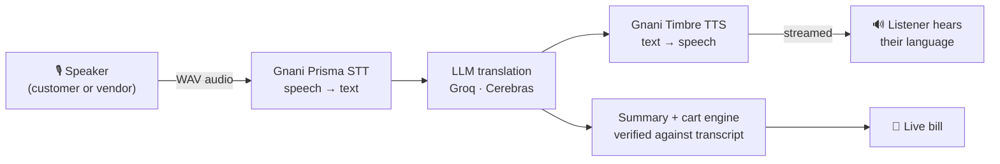

<div align="center">


# VoxMandi AI

### Talk. Translate. Trade.

**Every voice finds its language.** Real-time voice translation that lets a customer and a street vendor bargain, each in their own language.

[](https://voxmandi-ai.vercel.app/)


</div>

---

## The problem

India has 22 scheduled languages, and markets are where they meet. A Kannada-speaking shopper in Bengaluru buys vegetables from a vendor who grew up speaking Hindi, a tourist in Chennai haggles over silk in English, and a migrant worker in Pune just wants to know the price of rice. People get by with gestures, half-understood numbers and overcharging. Text translation apps don't help much here: vendors are busy with their hands, many people don't read the script, and nobody types mid-bargain.

## What VoxMandi does

VoxMandi turns one phone into an interpreter that sits between both people.

1. **Customer taps and speaks** in their language, for example *"ಒಂದು ಕೆಜಿ ಟೊಮೆಟೊ ಎಷ್ಟು?"*
2. **Vendor hears it in theirs:** *"एक किलो टमाटर कितने का है?"* (spoken aloud by Gnani TTS)
3. **Vendor replies by voice**, and the customer hears the answer in Kannada.
4. While they talk, VoxMandi **builds the bill on its own**: items, quantities, unit prices and a total, checked against what was actually said.

Nothing to type and nothing to read: both people just talk.

## Features

| | |
| --- | --- |
| 🎙️ **Two-way voice translation** | Separate mics for customer and vendor. Speech to text, translation and text to speech, streamed back as each step finishes. |
| 🇮🇳 **10 Indian languages** | Kannada, Hindi, Tamil, Telugu, Malayalam, Marathi, Bengali, Gujarati, Punjabi and English, in any pairing. |
| 🧾 **Smart shopping cart** | Picks up "add 2 kg onions", "make that 1 kg" and "remove the beans" from the conversation, plus the vendor's prices and any price changes. Items can also be edited or added by hand. Unit conversion (kg/g, L/ml, dozen/piece) and totals are deterministic code, not LLM guesses. |
| 🛡️ **Anti-hallucination checks** | Each extracted item must quote the conversation. Items whose quote isn't found are dropped, and numbers that can't be verified are flagged as uncertain. |
| 📝 **Market notes** | A live summary of products, quantities and prices mentioned so far. |
| 💬 **Market phrases** | One-tap starters like "How much does this cost?" or "Can you reduce the price?", translated live and playable without being added to the conversation. |
| 🧑‍🤝‍🧑 **Purchase history** | After the customer reviews the cart and taps **Confirm purchase**, it's saved on that device. VoxMandi never takes or records payment. |
| 📱 **Mobile-first** | Built for a phone held between two people at a stall, with a live API status indicator and a built-in demo conversation. |

## How it works



- **Speech:** [Gnani AI](https://gnani.ai): Prisma v2.5 speech-to-text and Timbre v2.5 text-to-speech, both built for Indian languages and accents.
- **Translation:** Groq (`openai/gpt-oss-120b` by default) behind a provider interface. Cerebras is a drop-in alternative.
- **Streaming:** `/api/translate` sends each pipeline stage (transcript, translation, audio) to the browser as soon as it's ready, so people hear the reply sooner.
- **Hosting:** Vercel serverless functions pinned to Mumbai (`bom1`) to cut round-trip time for Indian users.

## Tech stack

- **Framework:** Next.js 16 (App Router, Route Handlers), React 19, TypeScript
- **Styling:** Tailwind CSS 4
- **Validation:** Zod validation on every API request
- **AI:** Gnani STT/TTS · Groq / Cerebras (OpenAI-compatible)
- **Audio:** in-browser microphone capture converted to the WAV format Gnani accepts
- **Tests:** Node's built-in test runner for the cart engine (`npm test`)

## Project structure

```
app/
  api/translate/   streams the speech → translation → speech pipeline
  api/summary/     market notes + per-turn cart intents
  api/phrase/      starter phrases, translated live
  api/health/      provider status for the header indicator
components/        UI: market session, mic buttons, cart, history, phrases
lib/
  pipeline.ts      the shared voice pipeline used by both speakers
  gnani/           Gnani STT and TTS clients
  translation/     provider interface + Groq and Cerebras implementations
  cart/            deterministic cart math and local purchase storage
  summary.ts       transcript-grounded extraction with quote verification
  audio/           microphone recording and WAV conversion
tests/             cart engine tests
```

## Run it locally

```bash
git clone https://github.com/Gaganajain/voxmandi-ai.git
cd voxmandi-ai
npm install
cp .env.example .env.local   # then add your keys
npm run dev
```

Open http://localhost:3000. Without keys the app still runs and names the missing key, and **View demo** plays a sample conversation.

| Variable | Where to get it |
| --- | --- |
| `GNANI_API_KEY` | [app.gnani.ai](https://app.gnani.ai) (needs STT and TTS access) |
| `GROQ_API_KEY` | [console.groq.com/keys](https://console.groq.com/keys) |
| `TRANSLATION_PROVIDER` | optional: `groq` (default) or `cerebras` (then set `CEREBRAS_API_KEY`) |

Other optional settings are listed in [`.env.example`](.env.example).

<details>
<summary><b>Testing on a phone over local Wi-Fi</b></summary>

1. Connect the laptop and phone to the same Wi-Fi (or the phone's hotspot).
2. Find the laptop's IPv4 address with `ipconfig`.
3. Run `npm run phone` (production build) or `npm run dev:phone` (dev mode).
4. Allow Node.js on **Private networks** if Windows Firewall asks.
5. Open `http://<IPv4>:3000` in Chrome on the phone.
6. Phones only allow the microphone on HTTPS or `localhost`. Either enable `chrome://flags/#unsafely-treat-insecure-origin-as-secure` for that address, or use USB port forwarding from `chrome://inspect/#devices` and open `http://localhost:3000`.

The deployed version at [voxmandi-ai.vercel.app](https://voxmandi-ai.vercel.app/) is served over HTTPS, so none of this is needed there.

</details>

## Status indicator

| Label | Meaning |
| --- | --- |
| **LIVE** | All keys set, translation provider reachable, no real call has failed this session |
| **CONFIGURATION REQUIRED** | A key is missing. The app names which one. |
| **API ERROR** | A key was rejected or the latest real call failed. The menu says which service. |
| **DEMO** | A sample conversation with the mics turned off |

## Design notes

- **LLMs extract, code decides.** The model reports what was asked for and what prices were quoted. Matching, unit conversion and totals happen in plain TypeScript ([`lib/cart/cart.ts`](lib/cart/cart.ts)), so the bill is reproducible and tested.
- **Ambiguity is surfaced, not guessed.** If a product comes up again, the customer is asked whether it means "more" or "instead".
- **Privacy by default.** Purchase history lives only in the browser's localStorage, and API keys stay on the server.
- **Recordings cap at 29 s** to stay within Gnani's 30-second REST STT limit.

## Roadmap

- [ ] Vendor accounts with synced sales history
- [ ] Rate limiting and auth on the API routes
- [ ] Gnani streaming STT for lower latency
- [ ] Offline phrasebook for low-connectivity markets
- [ ] UPI-ready bill sharing (QR / WhatsApp)

---

<div align="center">

Built with **[Gnani AI](https://gnani.ai)** voice models for the **Great Indian AI Internship Challenge**

`#GnaniAI` · `#GreatIndianAIInternshipChallenge`

**[Try it live →](https://voxmandi-ai.vercel.app/)**

</div>
